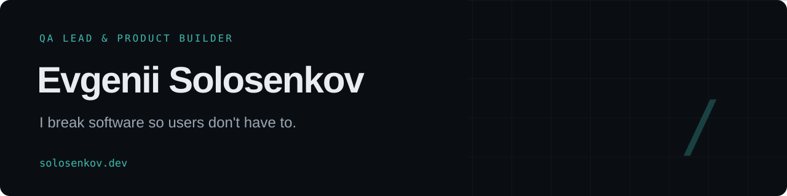
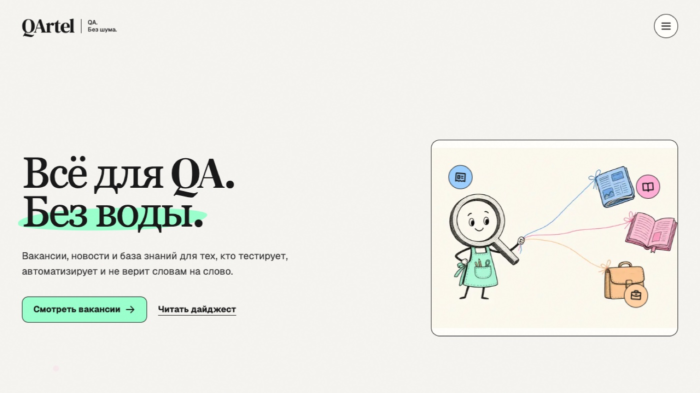
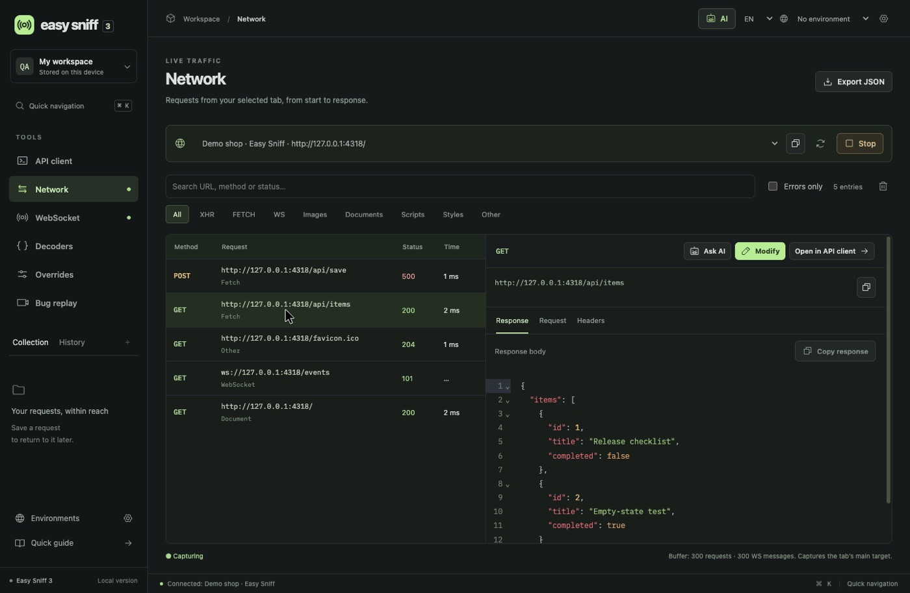
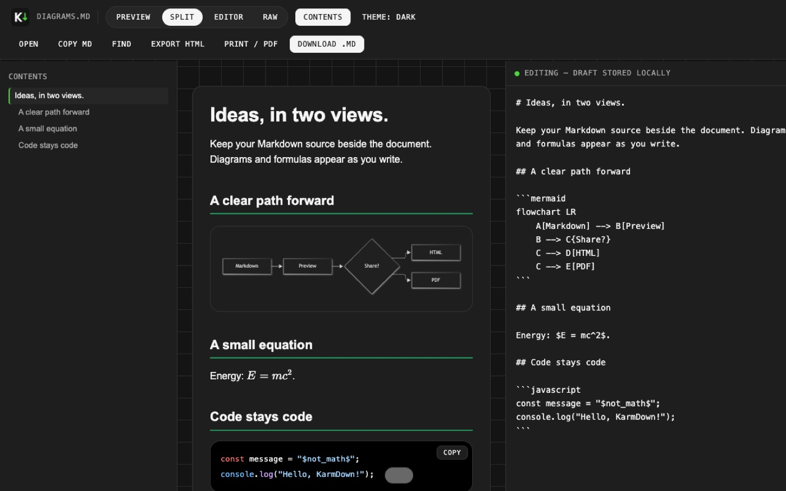

[English](README.md) / **Русский**

[Портфолио](https://solosenkov.github.io/?lang=ru) · [Telegram](https://t.me/solosenkoff) · [LinkedIn](https://linkedin.com/in/eugene-solosenkov) · [Почта](mailto:solosenkov@gmail.com)

## Думаю о качестве. Люблю создавать.

Я Евгений, **QA-лид и создатель продуктов**. 7+ лет работаю с вебом, мобильными приложениями и API. Управляю качеством нескольких продуктов, собираю команды и процессы с нуля и сам работаю с кодом.

А ещё создаю инструменты, которыми хочется пользоваться: браузерные расширения, утилиты для тестирования и полноценные продукты. Думаю о качестве на всём пути от идеи до релиза.

## То, что я создал

### [QArtel](https://qartel.net) / QA. Без шума.

Платформа для QA-сообщества: дайджесты новостей на русском, база знаний, вакансии и практика SQL/API. Создаю сам продукт и инструменты, на которых он работает.

[Открыть QArtel](https://qartel.net) · [Практика SQL и API](https://qartel.net/practice)

<table>
<tr>
<td width="50%" valign="top">

### [Easy Sniff](https://github.com/solosenkov/easy-sniff-extension)
**Рабочее пространство для браузерного QA**

Перехват HTTP и WebSocket, подмена ответов, запись бага с видео и технической шкалой событий. Офлайн-отчёт, который разработчик может изучить сам.

[Код и документация](https://github.com/solosenkov/easy-sniff-extension) · [Последний релиз](https://github.com/solosenkov/easy-sniff-extension/releases/latest)

</td>
<td width="50%" valign="top">

### [KarmDown](https://github.com/solosenkov/karmdown)
**Уютное место для Markdown**

Чтение, редактирование и поиск Markdown в Chrome. Живое превью, диаграммы Mermaid, формулы KaTeX и экспорт HTML/PDF. Без аккаунта и загрузки документов на сервер.

[Код и документация](https://github.com/solosenkov/karmdown) · [Последний релиз](https://github.com/solosenkov/karmdown/releases/latest)

</td>
</tr>
</table>

**[RikiTiki](https://riki-tiki.org)** / Основатель и разработчик. Многоязычный каталог детских и семейных услуг. Продуктовая стратегия, логика площадки и full-stack разработка, от идеи до запуска.

[Другие эксперименты и утилиты →](https://github.com/solosenkov?tab=repositories)

## Как я работаю

| Направление | Что делаю |
| :--- | :--- |
| **Управление QA** | Команды, стратегии с учётом рисков, критерии готовности релиза и понятная ответственность |
| **Тестирование** | Исследовательские сессии, контракты API, интеграции и воспроизводимые баг-репорты |
| **AI и агенты** | Тест-дизайн, расследования, оценка ответов и переиспользуемые процессы под контролем человека |
| **Создание продуктов** | Full-stack разработка, многоязычные интерфейсы и инструменты для реальных задач |

**Мои инструменты:** TypeScript / JavaScript / Python / SQL / Postman / Git / CI/CD / Next.js / Supabase

## Создадим то, что работает.

Нужен QA-лид, свежий взгляд на продукт или разработчик, который думает о качестве с первого дня?

**[solosenkov@gmail.com](mailto:solosenkov@gmail.com)** · [Telegram](https://t.me/solosenkoff) · [LinkedIn](https://linkedin.com/in/eugene-solosenkov) · [Портфолио](https://solosenkov.github.io/?lang=ru)
